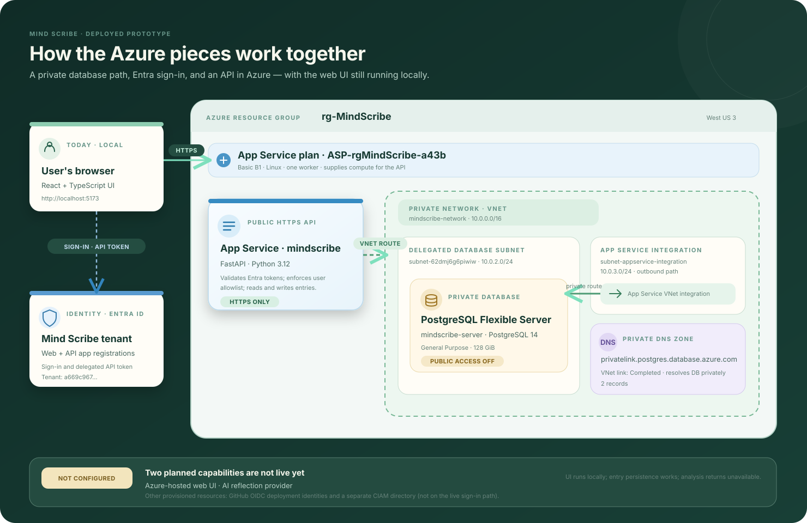

# Mind Scribe — Azure Architecture Technical Specification

**Status:** Deployed prototype
**Updated:** 2026-11-14
**Companion document:** [`techspec.md`](techspec.md) describes the proposed application design; this document records the Azure resources verified for the running prototype.

## 1. Purpose and current state

This document explains the Azure services that host, secure, and connect the current Mind Scribe prototype. It is intended as a learning guide as well as an architecture reference: each service is described in plain language, followed by its technical term and role.

The API is deployed to Azure App Service and stores journal entries in Azure Database for PostgreSQL Flexible Server. The database is reachable from the API over a private virtual network path and has public network access disabled. The React web UI is currently run locally at `http://localhost:5173`; it is **not yet hosted in Azure**. Microsoft Entra ID handles sign-in. Analysis is not connected to an AI service, so entries save successfully while reflection requests show as unavailable.

The diagram below separates the live request path from Azure resources that are provisioned for deployment or are not yet part of the application.

## 2. Live application flow

1. A user opens the React single-page application (SPA). Today, the app is served by a local Vite development server; a hosted UI is a future deployment.
2. The browser signs the user in with Microsoft Entra ID and receives an access token for the Mind Scribe API.
3. The browser sends the access token and API request over HTTPS to the public App Service endpoint. The API validates the token and checks its configured user allowlist.
4. The API connects to PostgreSQL over its App Service VNet integration. Private DNS resolves the database hostname to its private address inside the virtual network.
5. PostgreSQL stores the entry. The current API creates its `entries` table at startup if needed. If reflection analysis is requested, the API currently returns an explicit unavailable status; there is no model-provider call.

The database does not accept public network connections. The App Service endpoint is publicly addressable over HTTPS, but API operations require a valid Entra access token and an allowed user identity. The unauthenticated health route reports service/database readiness only.

## 3. Azure resource inventory

### Resources in `rg-MindScribe`

| Resource | Azure resource type | Region / scope | Purpose and current role |
|---|---|---|---|
| `rg-MindScribe` | Resource group | Subscription scope | **Resource group** — a management container that keeps related Azure resources together for access control, organization, and cost review. |
| `ASP-rgMindScribe-a43b` | `Microsoft.Web/serverFarms` | West US 3 | **App Service plan**, Basic B1 Linux, one worker. The plan supplies the compute capacity used by the API web app. |
| `mindscribe` | `Microsoft.Web/sites` | West US 3 | **Azure App Service web app**, Linux/Python 3.12. Runs the FastAPI API at `https://mindscribe-hmfcf6fdeufkdyfc.westus3-01.azurewebsites.net`. HTTPS-only is enabled. Its outbound VNet integration provides the private route to PostgreSQL. |
| `mindscribe-server` | `Microsoft.DBforPostgreSQL/flexibleServers` | West US 3 | **Azure Database for PostgreSQL Flexible Server**, PostgreSQL 14, General Purpose, Standard_D2s_v3, 128 GiB. Stores the journal entries. Public network access is disabled. |
| `mindscribe-network` | `Microsoft.Network/virtualNetworks` | West US 3 | **Virtual network (VNet)** — an isolated private network address space for Azure resources. Address space: `10.0.0.0/16`. It contains the database subnet and the App Service integration subnet. |
| `subnet-62dmj6g6piwiw` | VNet subnet | `10.0.2.0/24` | **Delegated subnet** for PostgreSQL Flexible Server. Delegation reserves this subnet for the PostgreSQL service. |
| `subnet-appservice-integration` | VNet subnet | `10.0.3.0/24` | **VNet integration subnet** for App Service. The web app is not placed inside this subnet; integration lets its outbound traffic reach private VNet destinations. |
| `privatelink.postgres.database.azure.com` | `Microsoft.Network/privateDnsZones` | Global | **Private DNS zone** — maps the PostgreSQL service hostname to its private network address so the API can connect without a public database endpoint. |
| `link-62dmj6g6piwiw` | Private DNS VNet link | Global, linked to `mindscribe-network` | Makes the PostgreSQL private DNS records resolvable by resources using the VNet. Link state was `Completed` when checked. |
| `TheMindScribe.onmicrosoft.com` | `Microsoft.AzureActiveDirectory/ciamDirectories` | United States | **Microsoft Entra External ID / CIAM directory** — a separate customer identity tenant resource. It is provisioned in this resource group, but the current Mind Scribe app registrations use a different Entra tenant, so this directory is not on the current sign-in path. |
| `oidc-msi-a742` | `Microsoft.ManagedIdentity/userAssignedIdentities` | West US 3 | **User-assigned managed identity** — an Azure identity that can be granted permissions without storing a password. It has a Website Contributor role assignment scoped to the `mindscribe` web app. No federated credential was present when checked; its intended deployment use should be confirmed. |
| `oidc-msi-bbd2` | `Microsoft.ManagedIdentity/userAssignedIdentities` | West US 3 | User-assigned identity with Website Contributor permission scoped to the `mindscribe` web app. It has a **federated identity credential** for GitHub Actions from the `stella-iacono/mind-scribe` repository's `main` branch, allowing a workflow to exchange its GitHub OIDC token for Azure access without a stored client secret. This is deployment access, not runtime API authentication. |

### Microsoft Entra application registrations

App registrations are identity-platform objects, not resources shown in the Azure Resource Manager resource-group inventory. They are still essential parts of this app:

| Registration | Application (client) ID | Purpose |
|---|---|---|
| `MindScribe Web` | `bbddb7ff-eced-4ebf-98a9-d277217ca54e` | Represents the browser-based SPA. It requests the API's delegated `access_as_user` permission. Its SPA redirect URIs include `http://localhost:5173` and the MSAL v5 bridge page `http://localhost:5173/redirect.html`. |
| `MindScribe API` | `1d85eb92-1a1d-4653-b32a-19f72588879e` | Represents the API as a protected resource. It exposes the delegated `access_as_user` scope. The registration is configured to issue v2 access tokens; the API validates issuer, signature, audience, required scope, and allowed user identity. |
| Entra tenant | `a669c967-0b02-4c07-8581-8ce8f40ae2bb` | Tenant that owns the two app registrations and issues the tokens used by the current web-to-API sign-in flow. It is separate from the provisioned CIAM directory listed above. |

The API uses an App Service `DATABASE_URL` setting to connect to PostgreSQL. The connection value is intentionally not documented here. It contains credentials and must remain in Azure configuration or a secret store, never in source control or a browser `VITE_` variable.

### Current database table

The API defines one table, `entries`, and calls SQLAlchemy `create_all` during startup to create it when missing. A successful journal submission has confirmed that the API can write entries to this database.

| Column | Current SQLAlchemy type | Purpose |
|---|---|---|
| `id` | `VARCHAR(36)`, primary key | Unique entry identifier. |
| `user_id` | `VARCHAR(255)`, indexed, not null | Entra user identity used to scope records to their owner. |
| `text` | `TEXT`, not null | Original journal entry. |
| `created_at` | Time zone-aware datetime, not null | Server timestamp for the entry. |
| `analysis_status` | `VARCHAR(16)`, not null | Current analysis state. |
| `analysis` | `JSON`, nullable | Structured analysis result; empty while analysis is unavailable. |
| `error` | `VARCHAR(64)`, nullable | Analysis error code when analysis fails. |

This is the schema the application defines, not a separately managed Azure table resource. `create_all` creates missing tables but does not update existing tables safely; use versioned migrations for future schema changes.

## 4. Network and trust boundaries

- **Browser-to-API:** HTTPS to the App Service public hostname. The browser sends a bearer access token; the API authenticates and authorizes each protected request.
- **API-to-database:** Private VNet route using App Service VNet integration, the PostgreSQL delegated subnet, and the linked private DNS zone. PostgreSQL public network access is disabled.
- **Browser-to-Entra:** The SPA uses MSAL Browser to authenticate with the Mind Scribe tenant and request the API delegated scope. Redirect URIs must match exactly, including scheme, hostname, port, and path.
- **Web UI hosting:** No Azure Static Web Apps resource exists yet. The currently registered API CORS origins are the localhost development origins. Before hosting the UI, add its exact HTTPS origin to API CORS configuration and register the hosted MSAL redirect URI.
- **Deployment identity:** GitHub OIDC-based federation is for deployment automation. It is separate from the signed-in user's access token and from API-to-database authentication.

## 5. Resources not yet deployed or configured

These are in the proposed design in [`techspec.md`](techspec.md), but are not part of the verified live request path:

| Capability | Current state | What it would do |
|---|---|---|
| Azure Static Web Apps (or another web host) | Not deployed | Host the production React SPA at an HTTPS URL. |
| Azure AI Foundry / Azure OpenAI model deployment | Not configured | Provide the server-side model used to generate journal reflections. |
| Azure Key Vault | Not present in the resource inventory | Centrally manage secrets or certificates; currently the API database URL is an App Service setting. |
| Azure Monitor / Application Insights | Not present in the resource inventory | Collect operational health and performance telemetry. Any future telemetry must exclude journal text, prompts, tokens, and other sensitive content. |
| Database migration tooling | Not configured | Apply reviewed, versioned changes to tables and columns. The API currently uses SQLAlchemy `create_all`, which creates missing tables but does not safely evolve an existing schema. |

## 6. Technical terms, in plain language

| Term | Definition |
|---|---|
| **Azure resource** | A manageable service or object in Azure, such as a web app, database, network, or identity. |
| **Resource group** | A logical container for related Azure resources; it is not itself a network or server. |
| **App Service plan** | The compute plan that provides capacity, operating system, and pricing tier for one or more App Service apps. |
| **Web app / App Service** | Azure's managed hosting service for a web application or API. Azure operates the underlying host; the project deploys the application code and configuration. |
| **Virtual network (VNet)** | A private IP network in Azure that lets cloud resources communicate using controlled network routes. |
| **Subnet** | A smaller IP range inside a VNet, used to separate and delegate network functions. |
| **Subnet delegation** | A declaration that a subnet is reserved for a particular Azure service, such as PostgreSQL Flexible Server. |
| **VNet integration** | An App Service feature that routes the app's outbound traffic into a VNet. It does not by itself make inbound app access private. |
| **Private DNS zone** | A DNS namespace whose records are visible to linked private networks; it lets a service hostname resolve to a private IP. |
| **Public network access** | Whether a service accepts connections through a public network endpoint. It is disabled for this PostgreSQL server. |
| **TLS / HTTPS** | Encryption and server identity checks for network traffic. HTTPS is HTTP protected by TLS. |
| **Microsoft Entra tenant** | A dedicated identity directory that holds users, groups, and app registrations and issues tokens for that organization. |
| **App registration** | An identity-platform definition for a client app or protected API, including its IDs, redirect URIs, and permissions. |
| **Single-page application (SPA)** | A browser application that loads once and updates its screens without a full page load; Mind Scribe's UI is React + TypeScript. |
| **Access token** | A short-lived, signed credential that a client presents to an API. The API validates it before returning protected data. |
| **Delegated permission / scope** | Permission allowing a client app to call an API on behalf of the signed-in user. Mind Scribe uses `access_as_user`. |
| **Managed identity** | An Azure-managed identity for an application or automation to access Azure services without keeping a client secret in code. |
| **OpenID Connect (OIDC) federation** | A trust relationship that lets an external identity provider, here GitHub Actions, exchange a signed identity token for Azure access without a stored long-lived secret. |
| **CORS** | Browser-enforced rules that let a server list which web origins may call it. CORS is not a replacement for API authentication or authorization. |
| **Database migration** | A versioned, repeatable change to a database schema, such as adding a column while preserving existing data. |

## 7. Operational notes and next architecture milestone

1. Keep the PostgreSQL public endpoint disabled and preserve private DNS/VNet connectivity.
2. Deploy the SPA to an Azure web-hosting service only after reviewing the deployment plan together. Then add the exact hosted origin to API CORS and add the exact hosted redirect URI to `MindScribe Web`.
3. Confirm which OIDC managed identity the GitHub workflow should use and reduce its permissions to the minimum needed. Review the extra identity with no federation before relying on it.
4. Add database migrations before changing the deployed table structure. Verify backups and retention separately; an application health check does not prove a backup can be restored.
5. Configure an AI provider only after reviewing its data-processing, retention, region, cost, and safety requirements. Continue to preserve entries if analysis is unavailable.

This document is a point-in-time description of the prototype, not a production-readiness or privacy certification. Recheck Azure configuration after infrastructure changes.
