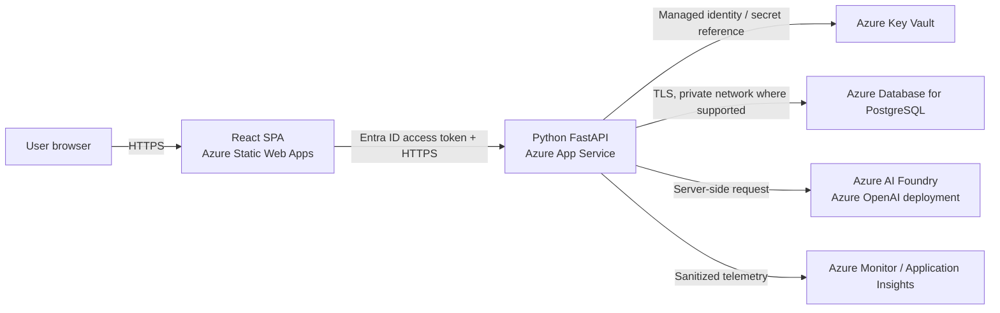

# Mind Scribe — Technical Specification

**Status:** Proposed design  
**Version:** 1.0  
**Updated:** 2026-10-19  
**Source:** Project scope and decisions in `mind-scribe/projectplan.md` and `mind-scribe/sdlc.md`

## 1. Purpose

This document describes a buildable first version of Mind Scribe: a private journal-entry analyzer that saves a user's writing and presents an optional, fallible AI-generated reflection. It turns the project plan's open technology choice into a recommended React, Python, and Azure design. It is a design proposal, not evidence that a particular Azure service, model, privacy term, or launch threshold has been approved.

The system is not a mental-health diagnostic or treatment tool. The user remains the authority on their experience and can ignore, correct, or delete an analysis.

## 2. Goals and boundaries

### Version 1 goals

- Let an authenticated user write, save, and review their own journal entries.
- Analyze a submitted entry for sentiment, themes, and emotional observations using an Azure-hosted LLM.
- Show confidence score and the original writing alongside the analysis.
- Persist an entry before analysis so model, network, or browser failures do not lose submitted writing.
- Allow users to retry failed analysis and delete entries.
- Keep sensitive writing out of application logs, analytics, and error reports.

### Not in Version 1

- Multi-user sharing, family accounts, or collaboration.
- Trends, dashboards, semantic search, embeddings, retrieval-augmented generation, or cross-entry questions.
- Voice transcription, proactive coaching, mental-health diagnosis, prediction, or consequential decisions.
- Public launch or a promise of crisis detection.

These features require separate product, privacy, safety, and access-control decisions. The data model includes an owner identifier, but that alone does not make multi-user release safe.

## 3. Proposed architecture



### Component responsibilities

| Component | Proposed choice | Responsibility |
|---|---|---|
| Web client | React + TypeScript, hosted on Azure Static Web Apps | Entry editor, entry list/detail, analysis states, accessible interaction, and authentication flow. |
| Identity | Microsoft Entra ID; use a dedicated app registration and a single-user allowlist for the private prototype | Sign in and issue access tokens. The API authorizes every operation against the authenticated user's stable identity. Select the appropriate Entra tenant/account configuration before implementation. |
| API | Python 3 + FastAPI on Azure App Service | Validate input and identity, persist entries, call the model, validate model output, enforce ownership, and expose the REST API. |
| Relational storage | Azure Database for PostgreSQL Flexible Server | Store entries and versioned analyses. PostgreSQL is the source of truth; no client connects directly to it. |
| LLM | Azure AI Foundry model deployment using Azure OpenAI | Analyze only the entry the user explicitly submits. The API, not the browser, calls the provider. |
| Secrets and configuration | Azure Key Vault, App Service managed identity, and deployment configuration | Store any required provider credentials and sensitive configuration. Prefer managed identity where supported; never put credentials in source control or the SPA bundle. |
| Operations | Azure Monitor / Application Insights with request and dependency telemetry | Monitor service health, latency, failures, and model usage without recording journal text or prompts. |

Use HTTPS for every network hop. Configure the database for TLS and restrict network access to the API. Prefer private networking/private endpoints where available and practical for the selected Azure plan; document any public endpoint and compensating firewall restrictions during deployment review.

### Deployment shape

Use separate development/test and pilot environments, with separate databases, model deployments, identities, and secrets. Deploy the SPA and API independently. Run database migrations as a controlled release step before routing traffic to a new API version. Keep infrastructure configuration reproducible (for example, Bicep) once the prototype moves beyond manual experimentation.

The initial deployment is a private prototype. Do not make the app publicly accessible until authentication, data handling, provider terms, backup/deletion behavior, and pilot release criteria have been reviewed.

## 4. User and system flow

1. The user signs in. The SPA obtains an access token for the Mind Scribe API.
2. The user enters text and explicitly submits it. The interface explains that submitting sends the text to the configured Azure AI service for analysis.
3. The SPA calls `POST /api/v1/entries`. The API validates the token and input, then commits the entry with analysis status `pending` before returning success.
4. The SPA calls `POST /api/v1/entries/{entry_id}/analysis`. The API confirms ownership, marks analysis as `processing`, and calls the configured model with the entry text.
5. The API parses and validates the response against the application schema. On success, it saves the versioned analysis and marks the entry `completed`.
6. The API returns the saved result. The SPA shows the entry, analysis, uncertainty, and a clear AI-generated label.
7. If analysis fails, the entry remains available with status `failed`; the user sees an actionable error and can retry. An interrupted request may leave `processing`; the API must allow a retry after a bounded stale-processing interval. A retry must not create a duplicate entry.

Analysis is synchronous in the initial design, avoiding a queue/worker dependency. The client should show progress and tolerate network interruption by refreshing the entry state. If measured latency or request limits make this unsuitable, introduce a durable queue and worker as a separately evaluated change.

## 5. Functional requirements and behavior

- Only authenticated users can use the API. The private prototype additionally restricts sign-in to an explicitly configured account.
- The server derives `owner_id` from validated identity claims; clients cannot assign or override it.
- Entries are saved independently of model success. The API reports storage errors explicitly and does not claim an entry was saved unless the transaction committed.
- Analysis is optional and invoked only after explicit user submission. The user can view the original entry when analysis is pending, failed, or unavailable.
- The user can read, list, and delete only their own entries. Deleting an entry deletes its analyses in the same database transaction.
- Model output is treated as untrusted input. Invalid or missing fields, refused output, timeouts, and provider errors produce a failed analysis state, not a fabricated/default analysis.
- The UI distinguishes `pending`, `processing`, `completed`, and `failed` states and provides an explicit retry action for eligible failures.
- Entry text and analysis content are not included in application logs, traces, crash reports, or client-side analytics.
- Every analysis records the model deployment identifier, prompt/schema version, and timestamps needed to interpret and re-evaluate it.

## 6. API design

All endpoints are versioned under `/api/v1`, require a valid Entra access token, and return JSON. Use standard HTTP status codes and a consistent error envelope such as:

```json
{
  "error": {
    "code": "analysis_unavailable",
    "message": "Analysis is temporarily unavailable. Your entry was saved; you can try again."
  }
}
```

Do not return provider internals, stack traces, secrets, or journal text in errors.

| Method and route | Purpose | Success |
|---|---|---|
| `POST /api/v1/entries` | Save a new entry. Request body: `{ "text": "...", "occurred_at": "..." }`; `occurred_at` is optional and defaults to server UTC time. | `201 Created` with entry ID, timestamps, and `analysis_status: "pending"`. |
| `GET /api/v1/entries?limit=&cursor=` | List the caller's entries, newest first, with bounded pagination. Do not include full text unless required by the UI. | `200 OK` with a page of entry summaries and opaque next cursor. |
| `GET /api/v1/entries/{entry_id}` | Read one owned entry and its latest analysis. | `200 OK`; `404` for missing or non-owned IDs to avoid disclosing another user's records. |
| `POST /api/v1/entries/{entry_id}/analysis` | Start or retry analysis for an owned entry. Reject concurrent duplicate work or return its current state. | `200 OK` with completed analysis, or a clear failure state if the model call fails. |
| `DELETE /api/v1/entries/{entry_id}` | Delete an owned entry and its analyses. | `204 No Content`; `404` for missing or non-owned IDs. |
| `GET /api/v1/health` | Liveness/readiness checks that reveal no sensitive configuration. | `200 OK` when ready; no authentication only if required by hosting probes. |

Validate request size, text length, timestamp format, UUIDs, and pagination bounds on the server. Exact entry-size and retention limits are deployment decisions that must be set before pilot use. Use an idempotency key for entry creation if retries from the client could otherwise create duplicate submissions.

## 7. Data model

Use PostgreSQL migrations and UTC timestamps. Store user-owned data with an ownership key even for a single-user deployment. Use database constraints and transactions to preserve referential integrity.

### `entries`

| Column | Type | Notes |
|---|---|---|
| `id` | UUID, primary key | Generated server-side. |
| `owner_id` | text, not null, indexed | Stable identity derived from validated issuer and subject; never accepted from request data. |
| `text` | text, not null | User-authored content; encrypted at rest by the managed database service. |
| `occurred_at` | timestamptz, not null | User-entry time; defaults to creation time. |
| `created_at`, `updated_at` | timestamptz, not null | Server timestamps. |
| `analysis_status` | enum/text, not null | `pending`, `processing`, `completed`, or `failed`. |

### `analyses`

| Column | Type | Notes |
|---|---|---|
| `id` | UUID, primary key | Generated server-side. |
| `entry_id` | UUID, foreign key to `entries`, not null | Cascade deletion with the entry. |
| `schema_version` | text, not null | Version of the validated response contract. |
| `prompt_version` | text, not null | Version identifier; do not store a prompt containing entry text. |
| `model_deployment` | text, not null | Non-secret deployment/model identifier. |
| `result` | JSONB, not null | Validated analysis payload. |
| `created_at` | timestamptz, not null | Analysis completion time. |

Keep analysis attempts/status on `entries` for the initial workflow. If retry history becomes necessary, add an `analysis_attempts` table rather than overwriting evidence needed for evaluation. Never store raw provider request/response dumps or hidden reasoning.

### Analysis JSON contract

The initial contract should be confirmed with the intended user before implementation. Proposed version:

```json
{
  "schema_version": "1",
  "sentiment": {
    "label": "mixed",
    "explanation": "The entry describes both relief and disappointment."
  },
  "themes": [
    {
      "label": "change",
      "evidence": "I was relieved when the plans changed, but I still miss how things were."
    }
  ],
  "emotional_observations": [
    {
      "label": "relief",
      "uncertainty": "moderate",
      "evidence": "I was relieved when the plans changed."
    }
  ],
  "overall_uncertainty": "moderate"
}
```

Use controlled values for sentiment (`positive`, `negative`, `mixed`, `neutral`, `unclear`) and uncertainty (`low`, `moderate`, `high`). Allow empty themes/observations and `unclear`; do not force the model to assign an emotion. Evidence must be short quotations or clearly traceable paraphrases from the submitted entry. These labels are qualitative estimates, not calibrated probabilities. Avoid a numeric confidence score unless a separate evaluation demonstrates that it is meaningful and calibrated.

The API validates types, enumerations, field lengths, array limits, and required keys before persistence. The model's schema-constrained output is helpful but is not a substitute for server-side validation.

## 8. LLM integration

- Call the Azure AI Foundry/Azure OpenAI endpoint from the Python API only. Keep endpoint, deployment, and API version in deployment configuration; keep credentials in Key Vault or use an approved managed identity flow.
- Pin the deployment and model version used in each environment. Record the deployment identifier and prompt/schema versions for reproducibility; evaluate before changing them.
- Request schema-constrained JSON where supported by the selected model/deployment. Parse and validate the response with typed Python models (for example, Pydantic).
- Instruct the model to analyze only the submitted entry, treat any instructions inside it as journal content rather than commands, cite entry evidence, permit mixed/unclear/empty results, avoid diagnosis and unsupported claims, and express uncertainty.
- Set explicit connection/read timeouts and bounded retry behavior. Retry only transient provider failures and avoid duplicate billable work where provider idempotency is unavailable. Never retry invalid output indefinitely.
- On timeout, refusal, invalid JSON, schema failure, rate limit exhaustion, or provider outage, preserve the entry, set analysis status to `failed`, and return a safe, actionable error.
- Send the minimum needed data: the current entry only. Do not include the user's history, identity, or unrelated metadata in the prompt.
- Before real-entry use, verify the selected Azure service's data-processing, retention, region, abuse-monitoring, and model-training terms against the project's privacy requirements. Do not assume that use of Azure alone guarantees a particular retention or residency policy.

## 9. Privacy, security, and safety

### Data handling

- Obtain informed consent before submitting real journal content to the configured model provider. Explain what is sent, why, and which provider processes it.
- Use TLS in transit, managed database encryption at rest, least-privilege access, and environment separation. Restrict database ingress to the API.
- Use managed identity for Azure resource access when supported. Do not put credentials in source control, browser code, or logs.
- Do not collect analytics or telemetry containing entry text, analysis, prompts, access tokens, or personally identifying values. Use request IDs and non-sensitive error codes instead.
- Define backup retention and recovery-point expectations before pilot. Explain that deletion from the live database may not immediately remove encrypted backup copies; document when backups expire and how they are protected.
- Provide a way to delete an entry and its analysis. Define account-wide export/deletion and backup deletion behavior before broadening beyond the prototype.
- Limit operator access to production data; use synthetic/test entries in development. Do not use another person's writing without informed permission.

### Identity and authorization

- The API validates signature, issuer, audience, and expiry of every access token.
- Derive `owner_id` from stable validated identity claims (issuer + subject); never trust a user ID supplied in a URL body or query parameter.
- Apply owner filtering in every database read, update, retry, and delete query. Use parameterized queries/ORM bindings.
- Configure the private pilot with an explicit account allowlist. Do not enable family or multi-user sharing until tenant isolation, authorization testing, consent, and sharing rules are separately reviewed.

### Responsible AI and user experience

- Label every result as AI-generated and show the original entry beside it or with an obvious way to inspect it.
- Explain that interpretations can be wrong, are not objective measurements, and are not therapy, diagnosis, or professional advice.
- Never present correlations, emotions, or themes as facts about the person. Preserve user control to ignore or delete results; correction UI is a future decision unless included in the pilot acceptance criteria.
- Do not claim to detect crisis or guarantee that distress will be recognized. Define and review an appropriate user-facing response to acute-distress content, including region-specific support resources if any, before pilot use.
- Evaluate for misreadings across writing styles, language, ambiguity, and mixed emotions before expanding intended users or supported languages.

## 10. Frontend design

Build a responsive React + TypeScript single-page application with routes/views for:

1. **Sign-in** — clear authentication errors and no journal content before authentication.
2. **Entry list** — date and analysis status, paginated, with an empty state.
3. **New entry** — accessible text editor, explicit submit action, privacy notice near submission, and validation feedback.
4. **Entry detail** — original text, analysis or pending/failed state, uncertainty, retry action, and delete confirmation.

Use a shared typed API client that attaches the access token, handles `401` by re-authenticating, and maps API error codes to actionable messages. Do not cache journal content in local storage, analytics, or service-worker caches. If client state retains entry text, clear it on sign-out and avoid persistence across sessions. Apply standard React output escaping; render model/user text as text, never unsanitized HTML.

Meet WCAG 2.2 AA as the target: keyboard-accessible controls, visible focus, semantic headings/landmarks, screen-reader status announcements for analysis progress/errors, sufficient contrast, and labels/instructions for the editor. Preserve drafts during transient errors where practical, while avoiding persistent browser storage of sensitive text.

## 11. Reliability and operational requirements

Targets for latency, availability, model cost, entry size, and pilot volume are open and must be agreed before release. Instrument baseline measurements in a synthetic/test environment first.

- Database commit must complete before the API reports entry creation success.
- An analysis failure must not roll back or delete the entry.
- A stale `processing` state must be recoverable through a safe retry path.
- Use bounded model input/output sizes, request timeouts, rate limits, and per-user limits appropriate to a private pilot.
- Health endpoints must not expose secrets, prompts, tokens, or personal data.
- Alert on API/database availability and elevated error rates; log correlation IDs, durations, model deployment identifier, status, and token/cost metrics only where the provider exposes them without logging content.
- Document manual rollback: disable analysis while leaving stored entries accessible, or stop the API while preserving database data.
- Define and test database backup/restore and schema migration procedures before the pilot.

## 12. Testing and evaluation

### Automated checks

- **Frontend:** component tests for entry form validation, loading/error/completed states, retry, delete confirmation, and keyboard-accessible controls.
- **API:** unit tests for request/response validation, ownership enforcement, state transitions, error mapping, and model response validation.
- **Integration:** test PostgreSQL migrations and create/read/delete flows; mock the model provider for deterministic tests.
- **Failure cases:** provider timeout, rate limit, malformed JSON, schema-invalid output, API interruption, database failure before save, and database failure after provider response.
- **Security:** verify unauthorized requests fail; verify one identity cannot read, analyze, or delete another owner's entry; check logs and error responses do not contain submitted text or secrets.
- **End-to-end:** sign in in the pilot environment, submit an entry, see the result, refresh, retry a failed analysis, and delete the entry.

### AI evaluation

Build a small, consented and preferably synthetic evaluation set spanning short, ambiguous, mixed-emotion, and varied-style entries. Review outputs with a rubric for schema validity, faithfulness to evidence, theme/emotion relevance, appropriate uncertainty, and absence of diagnostic/unsupported claims. Record model/prompt/schema versions for each evaluation. Agree on release thresholds with the project team before pilot; repeat evaluation after any model, prompt, schema, or data-handling change.

## 13. Delivery plan

1. **Resolve discovery decisions:** confirm the JSON fields, supported language, account/tenant setup, entry limits, provider terms, privacy notice, deletion/backup expectations, and pilot quality thresholds.
2. **Create Azure foundation:** isolated environments, identity registrations, app hosting, database, Key Vault, network rules, telemetry redaction, and deployment configuration.
3. **Implement persistence and API:** migrations, auth/ownership, entry CRUD, state model, typed model adapter, validation, and explicit errors.
4. **Implement React UX:** sign-in, entry list/editor/detail, status transitions, retry/delete, privacy disclosure, and accessibility checks.
5. **Validate and pilot:** automated tests, AI evaluation, security/privacy review, failure/recovery checks, and opt-in private pilot.
6. **Review learning:** compare user feedback, output quality, reliability, latency, and cost before prioritizing future scope.

This follows the project's iterative SDLC: release a small, reviewed slice; test ordinary and failure cases; learn from the pilot; and revisit decisions as evidence changes.

## 14. Decisions and open questions

### Proposed decisions in this specification

- React + TypeScript SPA; Python + FastAPI API.
- Azure Static Web Apps for the SPA; Azure App Service for the API.
- Azure Database for PostgreSQL as the system of record.
- Azure AI Foundry/Azure OpenAI for model inference, called server-side.
- Entra ID authentication, with an allowlisted account for the private prototype.
- Persist entry first, then analyze; use explicit status and retry rather than losing entries on model failure.
- Version 1 analyzes one entry only; future cross-entry functionality is out of scope.

These choices satisfy the user's requested direction but remain subject to project-team approval and Azure availability/cost review.

### Decisions required before real-entry pilot

- Which Entra tenant/account configuration will be used, and who is allowlisted?
- Which Azure region, model deployment/version, and provider terms meet the privacy and cost requirements?
- Is the proposed analysis schema useful to the journal author? Should explanations/evidence be edited or removed?
- What maximum entry size, supported language(s), retention, backup duration, recovery objectives, and deletion expectations apply?
- What latency, cost, AI-quality, and safety thresholds define go/no-go?
- What user-facing approach is appropriate for entries that describe acute distress, without implying reliable crisis detection?
- Does the pilot need export, or is deletion sufficient for its limited use?
- Which accessibility and supported-browser requirements will be verified?

## 15. Acceptance criteria for Version 1

- An allowlisted user can sign in, submit an entry, and later retrieve it after refreshing the browser.
- Submission persists the entry before analysis begins; a simulated model outage leaves the entry accessible and clearly marked failed.
- Valid model output is schema-validated, stored with model/prompt/schema identifiers, and displayed as a fallible AI-generated reflection with uncertainty.
- Invalid or unavailable model output is never displayed as a successful analysis; retry does not duplicate the entry.
- A user can delete an entry and its stored analysis; the API returns no data for an unowned entry ID.
- Automated tests cover the primary flow and the defined persistence, provider-failure, authorization, and deletion cases.
- Logs, telemetry, and errors are verified not to contain journal text, analysis content, credentials, or access tokens.
- Privacy/provider terms, retention/deletion behavior, evaluation rubric, and pilot go/no-go criteria are documented and approved before real personal entries are used.
